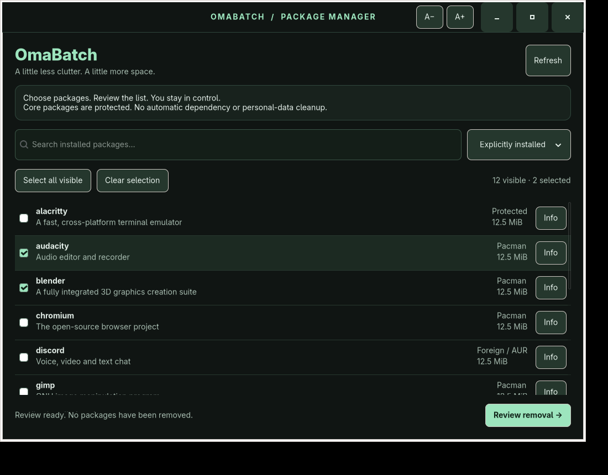

# OmaBatch

**A careful GUI batch uninstaller for Omarchy and Arch Linux.**

Pick installed packages, inspect their details, review the exact list, then confirm with pacman. A native GTK 4 interface with an Omarchy-inspired black-and-mint palette and adjustable, remembered text size.



*Screenshot uses example package data. Package details and sizes come from your own system when running normally.*

## Install in one line

Run as your normal desktop user on Omarchy or Arch Linux:

```bash
curl -fsSL https://raw.githubusercontent.com/RobbieUK1/OmaBatch/v1.0.0/install.sh | bash
```

Open **OmaBatch** from your application launcher. You can also run `~/.local/bin/omabatch` (or `omabatch` if `~/.local/bin` is on your PATH).

The installer downloads the **v1.0.0 tag**, checks prerequisites, and installs only OmaBatch under `~/.local`. It does not use sudo, install dependencies, refresh package databases, change your theme, or remove packages. Rerunning it is supported. Previous content-addressed app versions are retained for recovery.

If prerequisites are missing, install them first:

```bash
sudo pacman -S --needed python python-gobject gtk4 curl tar sudo alacritty
```

Python 3.10+ and GTK 4 are required. An existing Alacritty, Foot, Kitty or Xterm can be used instead of installing Alacritty. A working desktop session is needed to show the GUI. Do not run the app or installer with sudo.

Prefer to inspect the installer first?

```bash
curl -fsSL https://raw.githubusercontent.com/RobbieUK1/OmaBatch/v1.0.0/install.sh -o omabatch-install.sh
less omabatch-install.sh
bash omabatch-install.sh
```

## Use

1. Search by package name or description. The default view shows explicitly installed packages; choose **All packages** to include dependencies, or **Foreign / AUR** for foreign packages.
2. Tick packages individually or use **Select all visible**. Protected packages cannot be selected. Filter changes keep your selection; the counter tells you when selected packages are hidden. **Clear selection** clears everything.
3. Use **Info** for version, description, installed size, dependencies, reverse dependencies, installation reason and protection explanation.
4. Choose **Review removal**. OmaBatch asks pacman for a read-only transaction preview and refuses dependency-breaking or unexpected removal lists.
5. Read the exact package list and warnings. Choose **Open pacman confirmation** to open your terminal. The helper checks the package database again, then sudo may ask for your password. Pacman shows the final transaction and asks you to confirm. Answer **n** to cancel.

Use **A− / A+** in the title bar to change text size from 11–24 px. This preference is stored in `${XDG_CONFIG_HOME:-~/.config}/omabatch/settings.json`.

## Removal safeguards

- Removal uses **`sudo /usr/bin/pacman -R --confirm -- <selected names>`**. There is no recursive removal, cascade, dependency bypass, orphan cleanup, `--nosave`, or `--noconfirm`.
- Unselected dependencies are left installed. Package-manager backup rules remain enabled; eligible modified configuration files can become `.pacsave` files. OmaBatch does not perform personal-data or cache cleanup.
- Core system, kernel, boot, storage, networking, Hyprland/Omarchy, authentication and OmaBatch runtime packages are protected. Their complete required-dependency closures are also protected, including all installed providers of virtual dependencies. Owners of critical runtime files and installed kernel files provide additional protection for custom package names.
- The rules are intentionally conservative. **Select all** can still select applications you rely on; always read the review. No static protection policy can identify every custom service or locally essential application.
- Pacman performs its normal dependency checks. Removing optional dependencies may disable optional features; inspect **Info** and review warnings.
- Reviews expire after 15 minutes. A changed package database, missing package, protected target, malformed review or differing pacman preview stops the operation. Reviews are private, owned by your user, and checked again in the terminal.
- The GUI and helper remain unprivileged. Only pacman is elevated through sudo in an interactive terminal. No password is captured by OmaBatch and package names are never interpreted by a shell.

**Scope:** pacman-managed packages, including packages installed through yay/paru or other AUR tools. “Foreign” means absent from configured repository databases; it can also mean manually installed packages, not necessarily AUR packages. Flatpak and Omarchy web-app launchers are not managed by this release.

Pacman uninstall scripts and system hooks still run normally and may change system files or services. OmaBatch cannot undo a removal or control third-party package scripts. Backups are useful before any package changes. Read [pacman's removal documentation](https://man.archlinux.org/man/pacman.8.en#REMOVE_OPTIONS_(APPLY_TO_-R)) for its underlying behavior. OmaBatch is an independent project, not an official Omarchy tool.

## Build, run and test

No compilation, pip packages, AUR helper or custom privileged service is needed:

```bash
git clone https://github.com/RobbieUK1/OmaBatch.git
cd OmaBatch
python3 launch.py
```

Run the safety suite and check the installer:

```bash
python3 -m unittest discover -s tests -v
bash -n install.sh
```

GTK smoke tests need a display or Xvfb (`xorg-server-xvfb` and `xorg-xauth` on Arch):

```bash
xvfb-run -a env GDK_BACKEND=x11 GDK_SCALE=1 GDK_DPI_SCALE=1 GSK_RENDERER=cairo python3 tests/gui_smoke.py
```

The tests cover essential dependency protection, virtual providers, custom kernels, malformed and stale reviews, argument injection, exact removal lists, interactive privilege boundaries, package discovery, filtering, selection, text settings, information and review windows. Arch-only integration tests exercise real pacman against a disposable package database; no host packages are removed. The GUI smoke test uses example data. GitHub Actions also checks GTK and installation in an Arch Linux container.

Test a local install without writing to your usual app directories:

```bash
OMABATCH_PREFIX="$PWD/test-install" bash install.sh --local "$PWD"
./test-install/bin/omabatch --version
```

`OMABATCH_PREFIX` sets the install prefix (default `~/.local`). A custom prefix's desktop entry may not appear in your launcher unless its `share` directory is included in `XDG_DATA_DIRS`.

## Troubleshooting

- **“Stopped safely” / required by another package:** pacman refused the transaction. Change the selection. OmaBatch will not bypass this check.
- **Installed packages changed / review expired:** close the review, refresh, select again and review again.
- **Database is locked:** finish the other package-manager operation, then refresh. Do not delete the lock file while pacman is running.
- **Terminal or authentication problem:** run your terminal normally and verify that `sudo pacman -Q` works. Refresh after a failed or cancelled attempt. The terminal keeps pacman's output visible until you press Enter.
- **Application launcher has not updated:** run `~/.local/bin/omabatch` directly; log out and back in if needed.

## Remove OmaBatch itself

These paths contain only OmaBatch's per-user installation and settings. Review them before running:

```bash
rm -f ~/.local/bin/omabatch
rm -f ~/.local/share/applications/io.github.RobbieUK1.OmaBatch.desktop
rm -f ~/.local/share/icons/hicolor/scalable/apps/omabatch.svg
rm -rf ~/.local/share/omabatch
rm -rf ~/.config/omabatch ~/.cache/omabatch
```

Adjust these paths if you used a custom prefix or XDG configuration/cache directories.

## License

MIT. See [LICENSE](LICENSE).
